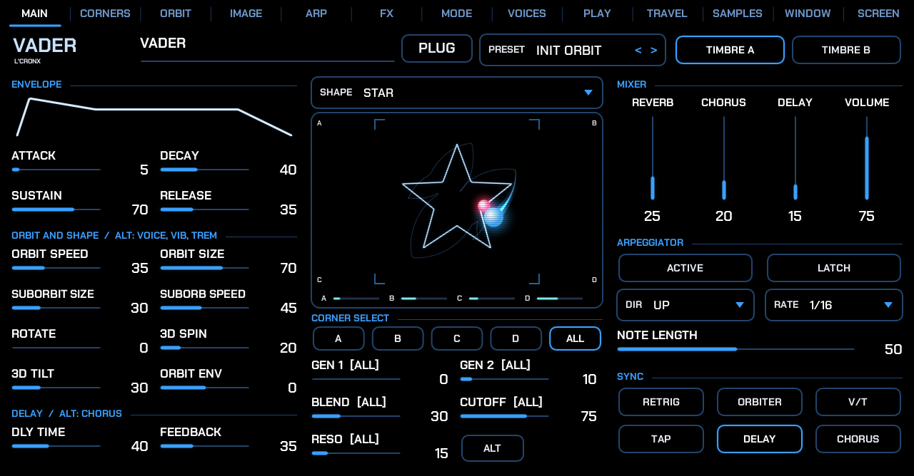
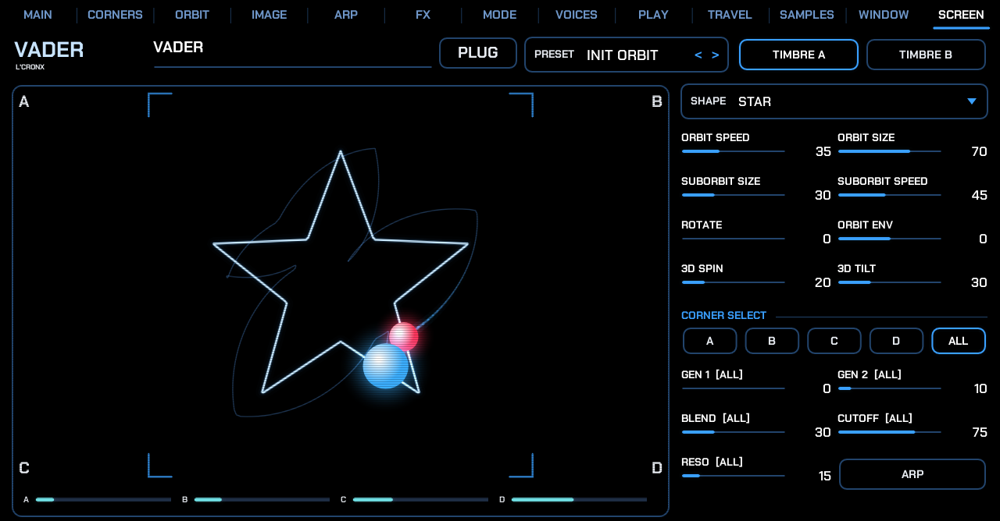
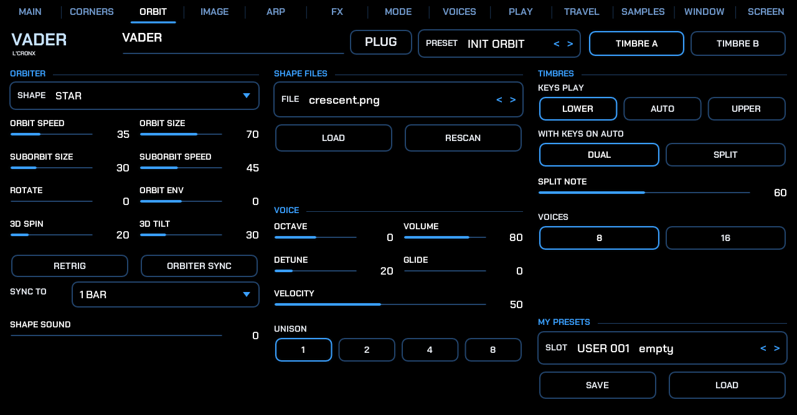
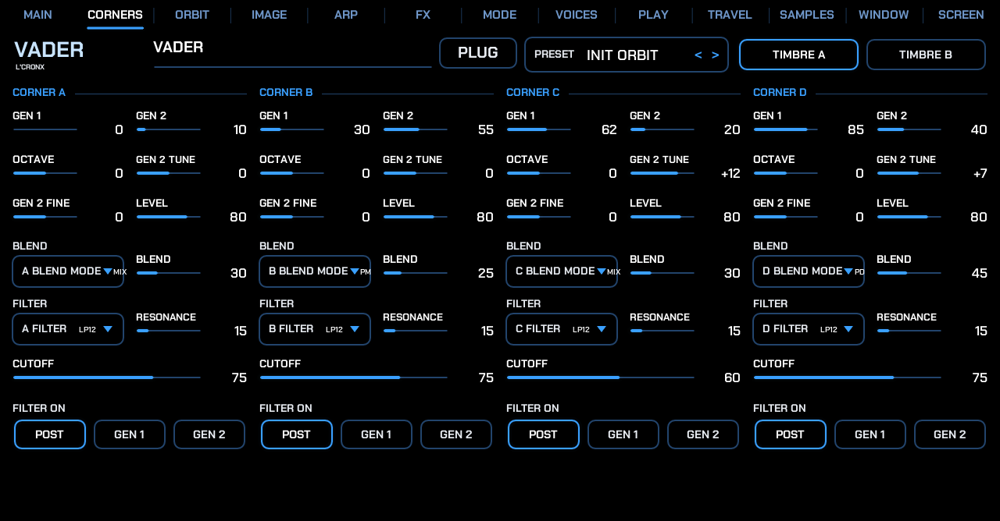
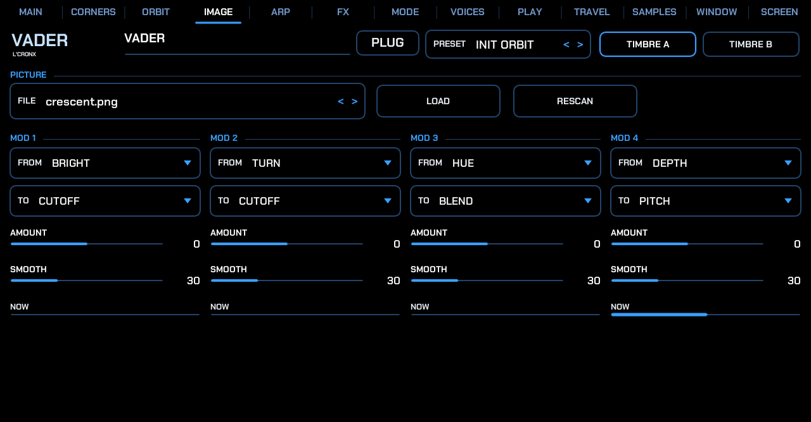
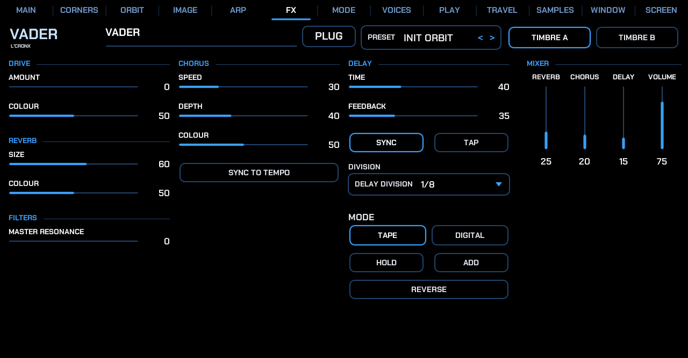

VADER as a VST3 and a VST2 plugin for Windows (64-bit and 32-bit) and Linux (x86_64), with the orbit screen drawn in the plugin's own window. This is the 0.10.7 desktop build: the same engine, pages and presets as the 0.10.7 Force plugin. New in 0.10.7: a picture (PNG/JPG) feeds the IMAGE page only and is drawn under the shape, BRIGHT reads real brightness, pictures up to 96 MB load, presets come back with the file they were saved with, and the dropdowns show their value again (see CHANGELOG.md).

Install steps, folders and limits: docs/DESKTOP.md (also inside each zip).

**Tested:** Linux (Steinberg VST3 validator 47/47, VST2 host test, screenshots of every page). Windows: cross-compiled, run under Wine, and loaded and played on a real Windows PC by the author. The Windows VST3 was not run through a validator. Please report what you find.
