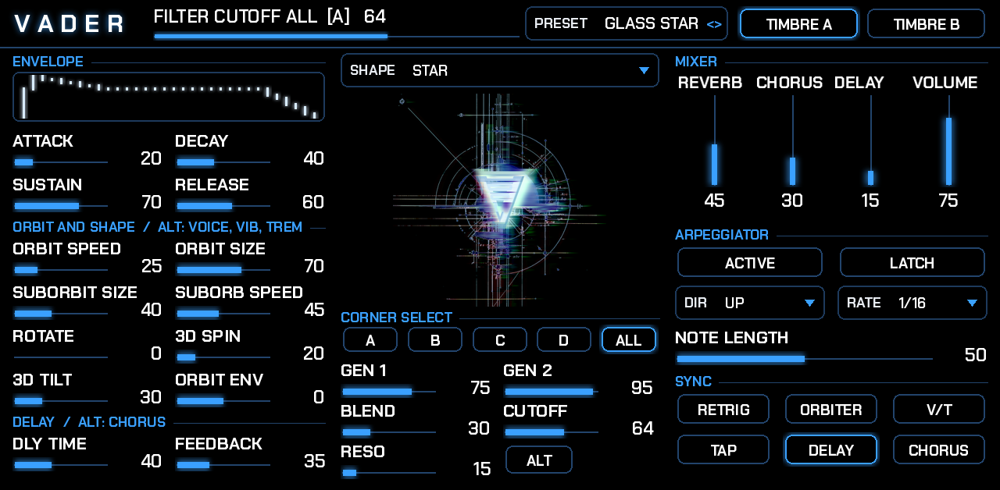
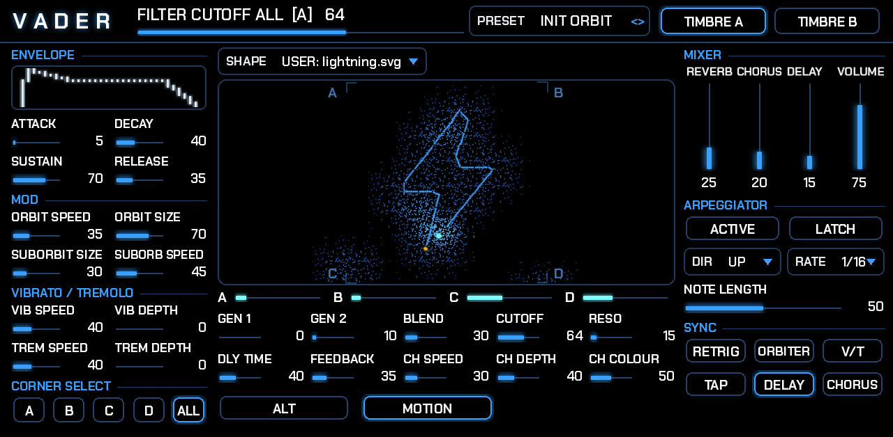
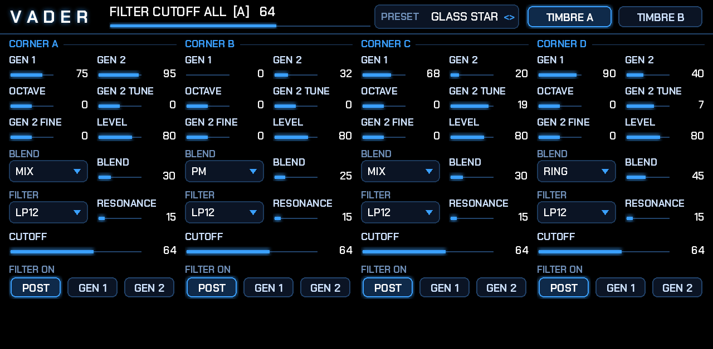
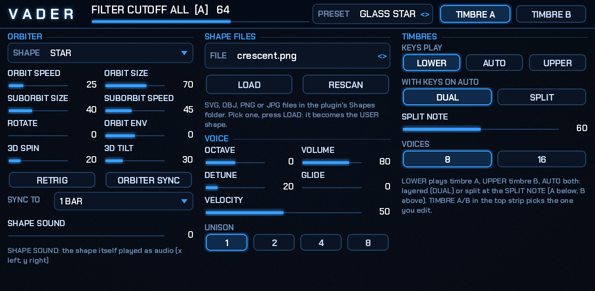
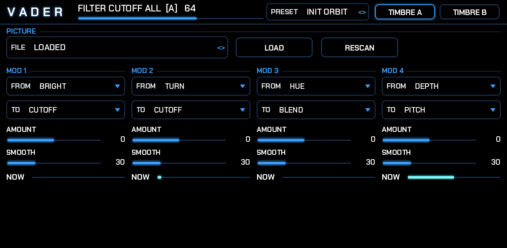

# VADER

**An orbit-based vector synthesizer for the Akai Force and MPC (MPC OS, VST2), by L'Cronx.**

A note plays four sound sources at once, one in each corner of a square. A point, the **orbiter**, travels around a
**shape** inside that square, and where it is decides how much of each corner you hear. Move the point and the sound
morphs. The shape can be one of fifteen built-in figures, or one you bring yourself: a drawing (SVG), a 3D wireframe
(OBJ) or a picture (PNG/JPG), traced into a line. The screen draws that line, the orbiter with its trail of dots and the envelope,
live, as glowing lines.



## The idea

I wanted a vector synth on the Force that works like the **Beetlecrab Audio Vector**: the same way of playing, and above
all that **screen**, with the orbiter tracing its path while the sound moves between four corners. I wanted the knobs as
on the hardware: envelope on the left, mixer and arpeggiator on the right, the screen in the middle with the overtone,
filter, delay and chorus controls under it, and the second functions on an ALT layer. It is the same layout, with the
parts moved around.

Then I wanted to go further than the hardware: **load any image, vector drawing or 3D shape and let it drive the
oscillators.** The shape becomes the orbiter's path, and it can also be played as sound itself, the way vector graphics
are drawn with audio on an oscilloscope.

The look: every knob is a **line**, a thin track with a thicker glowing blue line on top that grows with the value. No
panel boxes, so my own background picture shows through. There is a strip across the top of every page, like on my
BAZZLINE panels, showing the name and value of the last control touched. All the text is big, and so are the dropdowns.

VADER is its own engine, written for the Force's CPU. It is not a port and contains no Beetlecrab code, firmware or
artwork; it is not affiliated with Beetlecrab Audio.

**Inspired by and based on:**
- [Beetlecrab Audio Vector](https://beetlecrab.audio/vector/): its orbiter and suborbit, its four corners of two overtone
  generators with a blend stage and filter each, its corner matrix, and firmware 3.0's two timbres.
- Vector synthesis as Sequential's Prophet VS started it: mixing four sources from a point in a square.
- Oscilloscope vector graphics: [Vector Synthesis](https://github.com/macumbista/vectorsynthesis) by Derek Holzer
  (Lissajous figures, 2D and 3D shapes drawn with audio). This is behind the SHAPE SOUND and the 3D shapes.
- [OSS Enterprise](https://plugins4free.com/plugin/3435) by Ocean Swift Synthesis: a hybrid vector synth with XY
  movement.
- The MPC plugin framework [mpc-vst-plugins](https://github.com/sd88me/mpc-vst-plugins), which makes native MPC OS plugins
  possible.

## What's in it

- **Four corners, each two OVERTONE GENerators**: 32 additive spectra (sine to saw, pulse widths, vowels, organ
  drawbars, bells, primes...), swept smoothly by one knob, band-limited so nothing aliases.
- **BLEND per corner**: MIX, AM, PM, AM+PM, phase distortion, RING, FOLD.
- **A filter per corner**: LP12, LP24, BP, HP or a ladder, placed after the blend or on either generator (the corner
  matrix), plus MASTER RESONANCE.
- **The orbiter**: 15 built-in shapes (CIRCLE, FIGURE 8, STAR, SQUARE, TRIANGLE, two Lissajous, two roses, SPIRAL,
  HEART, ZIGZAG, SPIRO, and the 3D CUBE and ICOSA) or your own USER shape. It has speed, size, rotation, 3D spin and
  tilt, and a SUBORBIT circling the path point. It can sync to MPC's tempo, restart on each note, and grow or shrink
  with the envelope.
- **Your own shapes**: SVG, OBJ, PNG, JPG from the plugin's `Shapes` folder, or a `VADER Shapes` folder on your SD
  card or USB drive. Seven examples come with it.
- **SHAPE SOUND**: the shape itself played as audio, x on the left, y on the right.
- **Two timbres**: A and B, layered or split across the keyboard, each a complete sound. Unison up to 8 with detune,
  glide, vibrato, tremolo, 8 or 16 voices.
- **Arpeggiator** with six directions, six rates synced to MPC, 1 to 4 octaves, latch, and a 16-step pattern
  (ON, ACCENT, TIE, OFF).
- **Effects**: drive, chorus, ping-pong delay (synced, or free with TAP), reverb.
- **16 presets** in MPC's PRESET menu, from INIT ORBIT to SHAPE SCOPE, and **999 slots for your own** (MY PRESETS).
- **The IMAGE page**: a picture plays the sound. Four MODs read the picture under the orbiter (BRIGHT on a spectrogram
  colour scale, HUE, COLOUR, DEPTH as a landscape) or the outline (TURN, HEADING) and move CUTOFF, RESO, OCTAVE, PITCH,
  GEN 1, GEN 2, BLEND or LEVEL.
- **Six pages**: MAIN, CORNERS, ORBIT, IMAGE, ARP, FX. Q-Links are mapped on every page.

## The screen: on your phone

MPC draws a plugin's screen itself, from pictures and the plugin's values; a plugin cannot draw on the Force's display
directly, and every moving piece costs MPC a redraw (0.1 to 0.4 drew the screen from thousands of switchable pieces,
and a busy one crackled the audio). Since 0.6.0 VADER's screen is the **companion screen**: a web page served by the
plugin itself, on the Force's own network address, that any phone, tablet or laptop on the same Wi-Fi opens in its
browser:

- scan the **QR code** on the MAIN page with the phone's camera (or type the address shown on the ORBIT page; Apple
  devices can also use `vader.local`);
- the page draws the shape as a glowing line (3D shapes shaded by depth), the orbit line, the orbiter with its light
  trail and the two balls in their size colours, smoothly, with a **FULLSCREEN** button. On a phone it always draws in
  landscape: hold the phone sideways. "Add to Home Screen" gives it an icon that opens it full screen like an app;
- **LOAD SHAPE** on the page sends a picture (PNG, JPG), an SVG or an OBJ from the phone to the Force: it lands in the
  Shapes folder and plays at once;
- several devices can watch at the same time. The Force sends 30 small messages a second and draws nothing: the sound
  gets the whole machine.

On the Force, the MAIN page shows the VADER logo where the screen was (tap it to swap it for the QR code, tap again for the
logo), with bigger controls around it; the envelope line stays, drawn by MPC from 32 strokes that follow ATTACK, DECAY, SUSTAIN and RELEASE.

| | |
|---|---|
|  |  |
|  |  |

## Install

1. Download `VADER-<version>-mpc-armv7.zip` from [Releases](https://github.com/sunskiefer/VADER/releases).
2. Unzip it and follow `INSTALL.md` inside. It needs root SSH access to the device (MockbaMod, for example); the
   installer stops MPC, adds VADER to the plugin list and starts MPC again.
3. Load it on a track: Plugin → VST → **VADER**.
4. Put your own shapes in `L'Cronx - VST - VADER/Shapes/` inside the Synths folder you installed to, or in a
   folder called `VADER Shapes` at the top of your SD card or USB drive.

MPC OS 3.x. The skin uses the MPC OS 3 format.

### Desktop: VST3 + VST2 for Windows and Linux

VADER also builds as a desktop plugin with the orbit screen drawn in its own window. Install steps, folders and
limits are in **[docs/DESKTOP.md](docs/DESKTOP.md)**; build it with `desktop/build.sh linux|windows`.

Presets you save on the desktop (MY PRESETS, the `USER ###.vader` files) also load on the Force; see the
[user guide](docs/USER_GUIDE.md).

**PLUG** (0.9): press PLUG in the desktop window and it becomes the Force's VADER on your PC: the Force's screen drawn
large and sharp, every control showing the Force's value, and every control you move going to the Force at once.
Found on the network by itself, or by a typed address. See [docs/DESKTOP.md](docs/DESKTOP.md#plug-the-window-as-the-forces-screen).

## Use

Read the **[user guide](docs/USER_GUIDE.md)**. It covers every page, every control and every Q-Link, with recipes and
tips on making shapes.

The quick version: play a chord, then turn **ORBIT SPEED** and **ORBIT SIZE** and watch the orbiter. Pick a SHAPE.
Set CORNER SELECT to one corner and turn OVERTONE GEN 1 and 2, BLEND and the filter to change what that corner sounds
like. Press **ALT** for the second function of each knob.

## Build

```
pip install ziglang pillow numpy
./build.sh                 # -> build/package/L'Cronx - VST - VADER/
test/run_tests.sh          # the engine and the VST2 wrapper, under valgrind (NOVG=1 to skip it)
test/arm_sim.sh            # the engine test as ARM code under qemu (needs qemu-user)
```

The parameters live in one place, `tools/gen_params.py`. The pages are in `tools/vader_skin.py`, and
`tools/preview.py` draws them with the engine really playing (the pictures above). The engine is in `src/`.

## Status

**0.6.1 was tried on a Force.** Offline it passes the framework's VST2 host test, VADER's own engine
test (every preset, shape, blend mode and filter, the arpeggiator on MPC's clock, every example shape file, the state
round trip) and the companion screen's server test (the page, the WebSocket stream, an upload) on x86, and the engine
test as ARM code; the release zip passes the catalog check. 0.4.5 and 0.5.0 were tried on a Force (the sound is clean
with the screen quiet; the overlay experiment of 0.5.x drew well but made MPC's own screen lag, which is why the screen
moved to the phone).

## License

VADER is MIT-licensed (see [LICENSE](LICENSE)). Bundled: [mpc-vst-plugins](third_party/mpc-vst-plugins) (MIT),
[stb_image](third_party/stb) (public domain / MIT), Chakra Petch (SIL Open Font License, `art/fonts`). The desktop plugins also bundle [DPF](third_party/DPF) (ISC) and what it carries; see [desktop/THIRD_PARTY.md](desktop/THIRD_PARTY.md).
