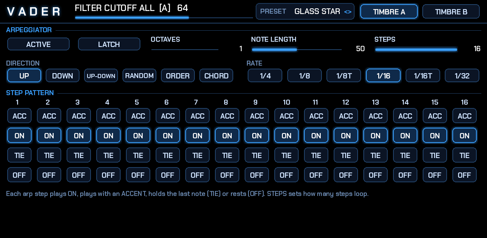
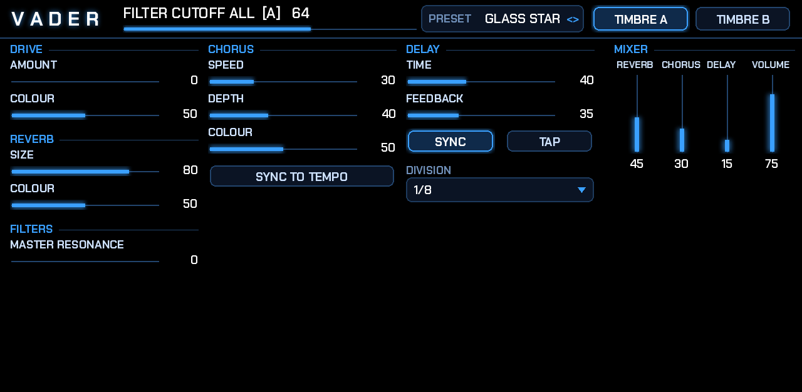

# VADER user guide

VADER is an orbit-based vector synthesizer for MPC OS (Akai Force, MPC). This guide goes through how it makes sound,
every page and control, the Q-Links, shapes of your own, and some recipes.

- [How VADER makes sound](#how-vader-makes-sound)
- [The strip at the top](#the-strip-at-the-top)
- [MAIN page](#main-page)
- [CORNERS page](#corners-page)
- [ORBIT page](#orbit-page)
- [ARP page](#arp-page)
- [FX page](#fx-page)
- [Your own shapes](#your-own-shapes)
- [Two timbres](#two-timbres)
- [Presets and saving](#presets-and-saving)
- [Q-Links](#q-links)
- [MIDI](#midi)
- [Recipes](#recipes)
- [Tips and troubleshooting](#tips-and-troubleshooting)

## How VADER makes sound

```
   A ───────────────── B        Every note plays all four corners at once.
   │    ·  ·  ·  ·     │        Each corner:  GEN 1 ─┐
   │  ·    path    ·   │                             ├─ BLEND ─ FILTER ─ LEVEL
   │  ·  ●───◌     ·   │                      GEN 2 ─┘
   │    ·  ·  ·  ·     │        ● the path point travels round the SHAPE
   C ───────────────── D        ◌ the orbiter circles it (the SUBORBIT)
                                What you hear: the four corners mixed by where ◌ is.
```

**Corners.** There are four, A (top left), B (top right), C (bottom left) and D (bottom right). Each is a small synth
of its own:
- **GEN 1 and GEN 2**, two overtone generators. Each knob sweeps through 32 harmonic spectra (below), blending smoothly
  from one to the next.
- **BLEND** joins them in one of seven ways (BLEND MODE), by an amount (BLEND):

| Mode | What it does |
|---|---|
| MIX | crossfades from GEN 1 to GEN 2 |
| AM | GEN 2 shapes GEN 1's level (tremolo at audio rate: sidebands) |
| PM | GEN 2 bends GEN 1's phase (FM-like brightness, bells, growls) |
| AM+PM | both at once |
| PD | GEN 2 bends GEN 1's waveform shape (phase distortion, Casio CZ-like sweeps) |
| RING | GEN 1 times GEN 2, mixed in (metallic, inharmonic with a detuned GEN 2) |
| FOLD | the two added and folded back (bright, buzzy as BLEND goes up) |

- **FILTER**: LP12 (soft low-pass), LP24 (steep low-pass), BP (band-pass), HP (high-pass) or LADDER (a resonant
  low-pass that saturates). **FILTER ON** places it: POST (after the blend), GEN 1 or GEN 2 (on that generator before
  the blend). This is the corner matrix.
- **OCTAVE** moves the whole corner, **GEN 2 TUNE** (semitones) and **GEN 2 FINE** (cents) move GEN 2 against GEN 1.
  Fifths, octaves and odd intervals change the character a lot, especially with AM, PM and RING.
- **LEVEL** sets how loud the corner is.

**The 32 spectra** each OVERTONE GEN sweeps through, from 0 to 100: SINE, SOFT, SQUARE, SAW, BRIGHT, HOLLOW, PULSE 10,
PULSE 20, PULSE 30, PULSE 40, VOX A, VOX E, VOX I, VOX O, VOX U, ORGAN 1 to 4, BELL, COMB, OCTAVES, FIFTHS, GLASS, REED,
BUZZ, AIR, HIGHS, PRIMES, SPREAD, FORMANT, METAL. Every 3 or so steps of the knob is the next one; in between, the two
neighbours are mixed. Each spectrum is built from up to 64 harmonics and thinned out for high notes, so nothing folds back
into noise.

**The orbiter.** A point, the *path point* (amber on the screen), travels round the SHAPE at ORBIT SPEED. A second
point, the *orbiter* (cyan), circles the path point (SUBORBIT SIZE, SUBORBIT SPEED). Where the orbiter is sets the mix
of the four corners: in the top-left corner you hear only A, in the middle all four equally. ORBIT SIZE scales the
shape: small keeps the orbiter near the middle (all four mixed), large reaches the corners. This movement is VADER's
modulation: there are no LFOs to patch, the shape *is* the modulation.

**Envelope.** One ADSR shapes the level of each note (and can grow or shrink the orbit: ORBIT ENV).

## The strip at the top

On every page:
- **VADER**, then the **readout**: the name and value of the last control you touched, and its line. Controls of a
  timbre show `[A]` or `[B]`; the main page's corner knobs also show the corner (A, B, C, D or ALL).
- **PRESET**: drag it, or turn its Q-Link, to pick one of the 16 presets (MPC's own PRESET menu lists them too).
- **TIMBRE A / TIMBRE B**: which timbre the pages edit. See [Two timbres](#two-timbres).

## MAIN page


**ENVELOPE** (left, top). The box draws the envelope as a line, from the four controls under it:
- **ATTACK**: rise time, 1 ms to 6 s. **DECAY**: fall to the sustain level, 5 ms to 10 s.
- **SUSTAIN**: the level held while the key is down. **RELEASE**: fade after the key is let go, 5 ms to 10 s.

**MOD** (with ALT off):
- **ORBIT SPEED**: how fast the path point goes round the shape, about one turn every 50 s up to 20 times a second
  (audio-ish buzz at the top). With ORBITER SYNC on, the speed comes from MPC's tempo instead (ORBIT SYNC on the ORBIT
  page).
- **ORBIT SIZE**: the shape's size in the square. 0 is the middle only.
- **SUBORBIT SIZE**: the radius of the circle the orbiter makes round the path point.
- **SUBORB SPEED**: how fast it circles (0.05 to 30 times a second; synced: 1 to 16 times per orbit).

**MOD** with ALT on: **ROTATE** (turns the shape), **ORBIT ENV** (the envelope grows the orbit, or shrinks it when
negative), **DETUNE** (unison spread), **GLIDE** (portamento).

**VIBRATO / TREMOLO**: VIB SPEED and VIB DEPTH (pitch, up to a semitone; the mod wheel adds to it), TREM SPEED and
TREM DEPTH (level). With VIB/TREM sync on (SYNC section), the speeds pick note values from 1 bar to 1/48.

**CORNER SELECT**: A, B, C, D or ALL: the corner the five corner knobs under the screen edit. ALL sets all four at
once (and shows corner A's value).

**SCREEN** (centre). SHAPE (a list: tap it to open, tap a shape to pick). The screen draws the shape in dim blue, the
orbiter's recent path in bright cyan, the path point (amber) and the orbiter (cyan). A, B, C and D mark the corners;
the four bars under it show how much of each you are hearing. It follows the newest note of the timbre you are editing.
If you load a shape file, it is drawn there too.

**The corner knobs** (ALT off): **OVERTONE GEN 1**, **OVERTONE GEN 2**, **OVERTONE BLEND**, **FILTER CUTOFF**,
**FILTER RESO**, for the corner(s) picked with CORNER SELECT. With ALT on, the same knobs are **DRIVE AMOUNT**,
**DRIVE COLOUR**, **REVERB SIZE**, **REVERB COLOUR** and **MASTER RESO** (resonance added to every corner's filter).

**DELAY TIME, DELAY FEEDBK, CHORUS SPEED, CHORUS DEPTH, CHORUS COLOUR**: see the [FX page](#fx-page).

**ALT** switches the second functions. **MOTION** turns the screen's movement on or off (the sound doesn't change).

**MIXER**: REVERB, CHORUS and DELAY levels, and VOLUME (the master).

**ARPEGGIATOR**: ACTIVE, LATCH, DIR (direction), RATE and NOTE LENGTH. See the [ARP page](#arp-page).

**SYNC**:
- **RETRIG**: each note starts its own orbit from the start of the shape (off: every note joins the orbit already
  running).
- **ORBITER**: the orbit follows MPC's tempo. While MPC plays, its position is locked to the song position, so it lands
  the same way every bar.
- **VIB/TREM**: vibrato and tremolo speeds in note values.
- **TAP**: tap twice in time to set the delay time (with DELAY sync on, it picks the nearest note value).
- **DELAY**, **CHORUS**: the delay time and chorus speed follow the tempo.

## CORNERS page


All four corners side by side, every control: GEN 1, GEN 2, OCTAVE (-2 to +2), GEN 2 TUNE (-24 to +24 semitones),
GEN 2 FINE (-50 to +50 cents), LEVEL, BLEND (mode list) and BLEND amount, FILTER (type list) and RESONANCE, CUTOFF, and
FILTER ON (POST, GEN 1, GEN 2). The Q-Links have one sub-page per corner.

## ORBIT page


**ORBITER**: SHAPE, ORBIT SPEED, ORBIT SIZE, SUBORBIT SIZE, SUBORBIT SPEED, ROTATE, ORBIT ENV, and for the 3D shapes
(CUBE, ICOSA, OBJ files) **3D SPIN** (how fast it turns) and **3D TILT** (how far it leans towards you). RETRIG and
ORBITER SYNC as on MAIN; **SYNC TO** sets how long one orbit takes when synced: 4 BARS, 2 BARS, 1 BAR, 1/2, 1/4, 1/8, 1/16.

**SHAPE SOUND**: plays the shape itself as a sound, at the note's pitch: its x as the left channel, its y as the right.
On an oscilloscope in X/Y mode, it draws the shape. A STAR sounds buzzy, a CIRCLE pure, a SPIRO rich. It turns with
ROTATE and 3D SPIN.

**SHAPE FILES**: FILE (drag it or turn its Q-Link to step through the files in the Shapes folders), **LOAD** (makes it
the USER shape of the timbre you are editing), **RESCAN** (reads the folder again after you added files). The field
shows LOADING..., LOADED, or why a file couldn't be read.

**VOICE**: OCTAVE (the timbre, -2 to +2), VOLUME (the timbre), DETUNE (unison spread, up to ±40 cents), GLIDE
(portamento), VELOCITY (how much velocity changes the level; 0: none), UNISON (1, 2, 4 or 8 voices per note, spread in
pitch and stereo).

**TIMBRES**: KEYS PLAY (LOWER, AUTO, UPPER), WITH KEYS ON AUTO (DUAL or SPLIT), SPLIT NOTE, VOICES (8 or 16). See
[Two timbres](#two-timbres).

**MY PRESETS**: SLOT, SAVE, LOAD: your own presets, 999 slots. See [Presets and saving](#presets-and-saving).

## ARP page



- **ACTIVE**: the keys you hold are played one after another instead of together.
- **LATCH**: the notes keep playing after you let go; the next chord replaces them.
- **OCTAVES**: 1 to 4 octaves up. **NOTE LENGTH**: how long each note lasts within its step.
- **STEPS**: how many steps of the pattern loop (1 to 16).
- **DIRECTION**: UP, DOWN, UP-DOWN, RANDOM, ORDER (the order you pressed them), CHORD (all held notes on every step).
- **RATE**: 1/4, 1/8, 1/8T, 1/16, 1/16T, 1/32, from MPC's tempo. While MPC plays, steps sit on MPC's grid; stopped, they
  run at the last tempo.
- **STEP PATTERN**: each step **ON** (plays), **ACC** (plays louder), **TIE** (holds the last note through this step),
  **OFF** (rests).

The arpeggiator feeds both timbres the way the keys do (KEYS PLAY).

## FX page



In this order after the voices:
- **DRIVE**: AMOUNT (soft saturation, level kept), COLOUR (dark to bright before it saturates).
- **CHORUS**: SPEED, DEPTH, COLOUR (darker below the middle; above it, brighter with some feedback for a flanger edge),
  SYNC TO TEMPO.
- **DELAY**: TIME (10 ms to 1.5 s), FEEDBACK, SYNC (then DIVISION: 4 BARS to 1/16), TAP. A stereo ping-pong with darker
  repeats.
- **REVERB**: SIZE (room to hall, up to 8 s), COLOUR (dark to bright).
- **FILTERS**: MASTER RESONANCE adds resonance to all four corners' filters.
- **MIXER**: the REVERB, CHORUS and DELAY levels, and VOLUME. A soft limiter at the end keeps VADER from clipping.

## Your own shapes

Put files in either place:
- the `Shapes` folder of the plugin (`ANDREALPHEUS - VST - VADER/Shapes/` in the Synths folder it is installed in);
- a folder called **`VADER Shapes`** at the top of your SD card or USB drive (make it on your computer, copy your files in,
  put the card or drive in the Force). Its files show with the drive's name in front, like `[CARD] logo.svg`.

Subfolders work, two levels deep. On the ORBIT page: press **RESCAN** if you just added files, pick the FILE, press
**LOAD**. The shape becomes the USER shape of the timbre you are editing.

| Format | What VADER uses |
|---|---|
| **SVG** | the lines: `path` (all commands, curves smoothed into lines), `polygon`, `polyline`, `line`, `rect`, `circle`, `ellipse`. Every part is joined in drawing order into one line. Transforms are ignored. |
| **OBJ** | the wireframe: every edge of every face (`f`) and line (`l`), walked as one line. It turns in 3D like CUBE and ICOSA (3D SPIN, 3D TILT). |
| **PNG, JPG** | the outline of the biggest shape in the picture, light or dark, whichever is the smaller part (a black logo on white, or a white one on black). |

Tips:
- **One continuous line works best.** Several separate parts are joined by straight jumps, which the orbiter crosses.
- **Simple, bold pictures** trace best: a silhouette, a logo, a hand-drawn closed line. Photos rarely give a clean shape.
- Size and position don't matter: every shape is centred and fitted in the square, keeping its proportions.
- A wide shape reaches the side corners (A/C and B/D); a tall one the top and bottom corners. Rotate it (ROTATE) to
  change which corners it visits.
- The project saves the file's name. When it opens again, VADER loads the file again; if it has gone (or the card is
  out), the timbre plays a CIRCLE.
- On the screen, your shapes and the 3D shapes are drawn with the fine tiles; the built-in 2D shapes as crisp pictures.

Examples included: `lightning.svg`, `infinity.svg`, `wave.svg`, `pyramid.obj`, `torus.obj`, `crescent.png`, `gear.png`.

## Two timbres

VADER holds two complete sounds, **timbre A** and **timbre B**. **TIMBRE A / TIMBRE B** in the top strip picks which one
the pages edit. Everything is per timbre except the effects, the mixer, the arpeggiator and the play settings.

**KEYS PLAY** (ORBIT page):
- **LOWER**: only timbre A plays.
- **UPPER**: only timbre B plays.
- **AUTO**: both, as **DUAL** (layered: every key plays both) or **SPLIT** (keys below SPLIT NOTE play A, from it up B).

**VOICES**: 8 or 16 notes at once. With both timbres playing, each gets half. Unison uses one voice per unison voice.

Loading a timbre from a preset: presets set both timbres (most set B the same as A).

## Presets and saving

16 presets, in the PRESET field and MPC's PRESET menu:

| # | Preset | |
|---|---|---|
| 0 | INIT ORBIT | the starting point: a star, four different corners |
| 1 | GLASS STAR | high, glassy spectra with ring and PM, big reverb |
| 2 | DARK FIGURE | ladder filters, low, driven: a bass/lead |
| 3 | VOX CIRCLE | the vowel spectra in a circle: a choir-ish pad |
| 4 | BELL CUBE | PM bells on a turning cube |
| 5 | PWM ROSE | the pulse widths, two unison voices |
| 6 | FM SPIRAL | PM and AM+PM in every corner, the spiral reaching further out |
| 7 | ARP HEART | the arpeggiator with a step pattern, synced orbit |
| 8 | DUAL PAD | timbre B an octave up, layered (KEYS on AUTO, DUAL) |
| 9 | SPLIT BASS/LEAD | timbre A a bass below the split, B a lead above |
| 10 | METAL ICOSA | ring and fold on a turning icosahedron |
| 11 | SWEEP LISSA | four filter settings, swept by a Lissajous figure |
| 12 | ORGAN SQUARE | the organ spectra, tremolo, chorus |
| 13 | FOLD ZIGZAG | fold in every corner, more towards D |
| 14 | AIR SPIRO | airy spectra on a spirograph, long reverb |
| 15 | SHAPE SCOPE | the SHAPE SOUND up front |

A preset keeps what you are editing (timbre, corner), the ALT and MOTION switches, the file and the voice count.

**MY PRESETS** (ORBIT page, bottom right): 999 slots for your own sounds.
- **Save**: turn **SLOT** to a number (it shows `empty` or `saved`), press **SAVE**. It shows `SAVED`. Saving to a
  slot that has a sound replaces it.
- **Load**: turn SLOT to a saved one, press **LOAD**. It shows `LOADED` (or `EMPTY SLOT`).
- A slot holds everything: both timbres, the effects, the arpeggiator and the name of the loaded shape file.
- They are files in `ANDREALPHEUS - VST - VADER/User Presets/` (`USER 001.vader` ...): copy that folder to back them up
  or to take them to another Force.

Your sound is also saved with the MPC project or program, as with any plugin.

Changing preset (or loading a slot) stops every note that was playing, so nothing keeps sounding.

## Q-Links

Each page has its own Q-Links. On the Force, the knob row shows the first 8 of a set; the second bank the next 8.

| Page | Set | Q-Links 1-8 | Q-Links 9-16 |
|---|---|---|---|
| MAIN | MAIN 1 | GEN 1, GEN 2, BLEND, CUTOFF, RESO, ORBIT SPEED, ORBIT SIZE, SUBORBIT SIZE | ATTACK, DECAY, SUSTAIN, RELEASE, SUBORB SPEED, REVERB, DELAY, VOLUME |
| MAIN | MAIN 2 | DELAY TIME, DELAY FEEDBK, CHORUS SPEED, CHORUS DEPTH, CHORUS COLOUR, VIB SPEED, VIB DEPTH, TREM SPEED | TREM DEPTH, NOTE LENGTH, CHORUS, DRIVE AMOUNT, DRIVE COLOUR, REVERB SIZE, REVERB COLOUR, MASTER RESO |
| CORNERS | CORNER A to D | GEN 1, GEN 2, BLEND, CUTOFF, RESONANCE, LEVEL, GEN 2 TUNE, GEN 2 FINE | OCTAVE, BLEND MODE, FILTER, FILTER ON |
| ORBIT | ORBIT | ORBIT SPEED, ORBIT SIZE, SUBORBIT SIZE, SUBORBIT SPEED, ROTATE, ORBIT ENV, 3D SPIN, 3D TILT | SHAPE, SHAPE SOUND, DETUNE, GLIDE, OCTAVE, VOLUME, VELOCITY, FILE |
| ARP | ARP | ACTIVE, LATCH, DIRECTION, RATE, OCTAVES, NOTE LENGTH, STEPS | |
| ARP | STEPS 1-8, STEPS 9-16 | the steps | |
| FX | FX | DRIVE AMOUNT, DRIVE COLOUR, CHORUS SPEED, CHORUS DEPTH, CHORUS COLOUR, DELAY TIME, DELAY FEEDBACK, REVERB SIZE | REVERB COLOUR, MASTER RESONANCE, REVERB, CHORUS, DELAY, VOLUME, DIVISION, CHORUS SYNC |

A Q-Link on a main-page corner knob edits the corner picked with CORNER SELECT. Double-tap any line to set its value
precisely (MPC's knob overlay).

## MIDI

- Notes, velocity, pitch bend (±2 semitones), mod wheel (adds vibrato), sustain pedal, all notes off.
- **CC 20 to 35** move the MAIN page's first Q-Link set (CC 20-23 the first column...), and **NRPN** n sets parameter n,
  for controllers and MPC's own automation (the mpc-vst-plugins conventions).
- Every control can be automated in MPC like any plugin parameter. The screen's parts are parameters too (SCREEN 1 to
  512, ENV LINE, CORNER MIX, READOUT LINE): they are VADER's display, so don't automate those.

## Recipes

- **Evolving pad**: VOX CIRCLE, ORBIT SPEED low, SUBORBIT SIZE up, ATTACK and RELEASE long. Set corner C to a high GEN 2
  TUNE (19) for shimmer.
- **Rhythmic morph**: ORBITER sync on, SYNC TO 1 BAR, shape SQUARE: each side of the square is a beat on a different
  corner pair. Try ZIGZAG or STAR at 1/2.
- **Bell to growl**: BELL CUBE, then ORBIT ENV negative: the orbit shrinks as the note sounds, so it starts at the
  corners and ends in the middle mix.
- **Wobble bass**: DARK FIGURE, ORBITER sync on, SYNC TO 1/4, CORNER SELECT A, FILTER CUTOFF low; corner D's cutoff
  high: the figure-8 sweeps between them.
- **Draw your sound**: draw a closed line in any vector editor, save as SVG, LOAD it, then SHAPE SOUND up: hear the
  drawing, and let it move the corners at the same time.
- **3D motion**: load `torus.obj`, 3D SPIN up, 3D TILT around 60: the projected path changes as it turns, so the orbit
  never quite repeats.

## Tips and troubleshooting

- **No sound**: check LEVEL on the CORNERS page, the timbre's VOLUME on the ORBIT page, the MIXER VOLUME, and KEYS PLAY
  (UPPER plays only timbre B).
- **Only one corner sounds**: ORBIT SIZE high and SUBORBIT SIZE low make the orbiter visit the corners one at a time;
  lower ORBIT SIZE to mix more.
- **Clicks on fast orbits**: that's the mix changing very fast (ORBIT SPEED near the top is meant to buzz). Lower it, or
  raise SUBORBIT SIZE so the jumps are smoothed.
- **"NO FILES IN Shapes/"**: put files in the plugin's Shapes folder or `VADER Shapes` on the card, and press RESCAN.
- **A file won't load**: the field says why (not an SVG/OBJ/PNG/JPG, no lines found, no shape found in the picture).
  Pictures: use a high-contrast silhouette.
- **CPU**: lower VOICES to 8, UNISON to 1, and turn MOTION off in a heavy project (that saves MPC's screen CPU, not
  the sound's).
